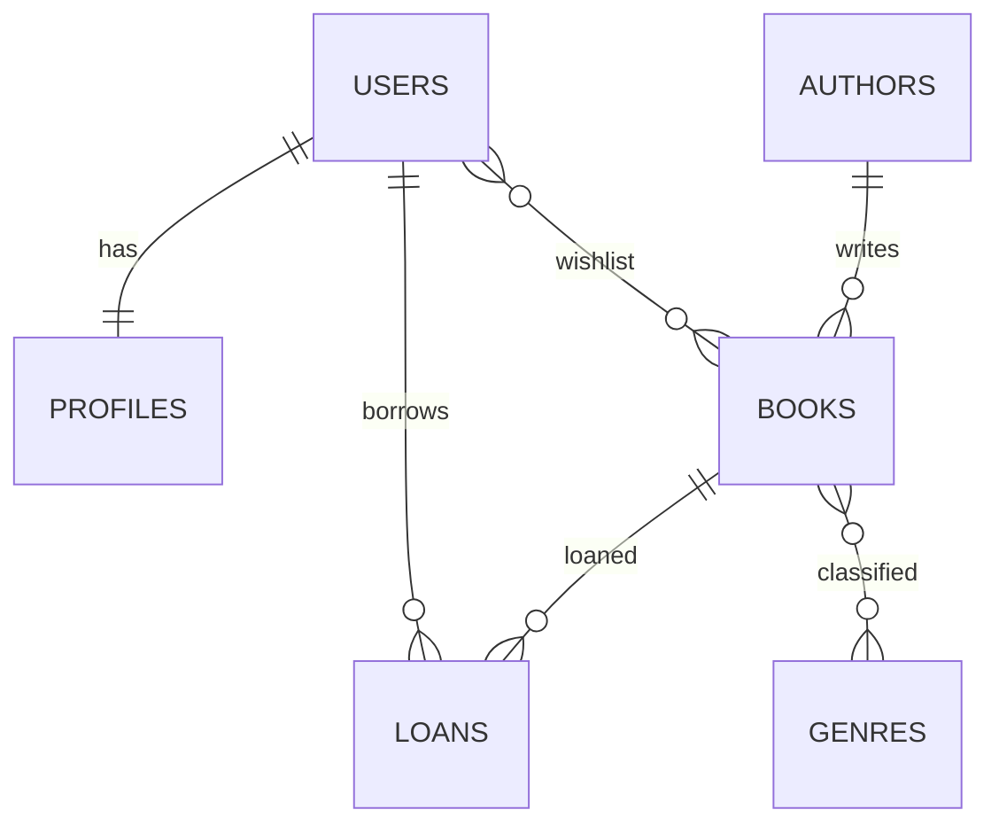

# Схема базы данных BookNest

Схема нормализована до 3NF и содержит восемь таблиц. Связи: `authors 1:N books`,
`books M:N genres` через `book_genres`, `users 1:1 profiles`, а также выдачи и wishlist.



Запуск вручную в PostgreSQL 17:

```bash
psql -d booknest -f db/schema.sql
psql -d booknest -f db/seed.sql
psql -d booknest -f db/queries.sql
psql -d booknest -f db/explain.sql
```

`ix_books_title_lower` обслуживает регистронезависимый поиск по префиксу, а частичный
`ix_loans_due_active` сокращает просмотр при отчёте о просроченных активных выдачах.
Планы следует сохранить до и после создания индексов командой `\o docs/lab8/explain.txt`.
Прикладная схема поднимается только через `alembic upgrade head`; `create_all()` используется
исключительно внутри изолированных тестов.
